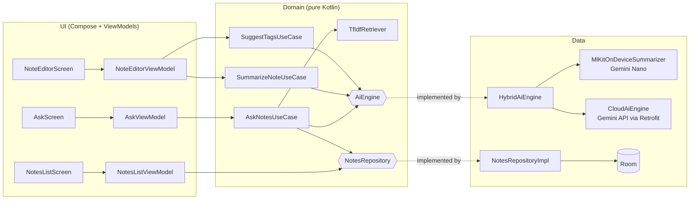

# Smart Notes AI ✨

An Android notes app with **hybrid on-device + cloud generative AI**.

- **Summarise notes on-device** with **Gemini Nano** (ML Kit GenAI / Android AICore), private and offline, with automatic **cloud fallback** to the Gemini API.
- **Auto-tag notes** using Gemini **structured output** (JSON schema), not fragile text parsing.
- **Ask your notes** using **RAG** (retrieval-augmented generation): on-device TF-IDF retrieval picks the relevant notes, and Gemini answers using only those, citing its sources. Answers **stream in token by token** over server-sent events.

Built with Kotlin, Jetpack Compose (Material 3), MVVM with unidirectional state, Clean Architecture, Hilt, Room, Coroutines/Flow, Retrofit + kotlinx.serialization, type-safe Navigation Compose, and JUnit/MockK tests on GitHub Actions CI.

## Architecture



## Getting started

1. Open the project in a recent **Android Studio**.
2. Get a free Gemini API key at <https://aistudio.google.com/apikey>.
3. Copy `local.properties.example` to `local.properties` and set `GEMINI_API_KEY=...` (this file is git-ignored).
4. Run on a device or emulator (minSdk 26).
   - On-device summaries need a device that supports Gemini Nano through AICore (e.g. recent Pixel / Galaxy flagships). Everywhere else the app automatically uses the cloud. The summary card shows which one ran.

Run tests: `./gradlew testDebugUnitTest`

> Security note: for a portfolio/demo app the key lives in `BuildConfig`. A production app should call Gemini via a backend or Firebase AI Logic with App Check, so the key never ships in the APK.

## Project structure

```
app/src/main/java/com/yashtandon/smartnotes/
├── domain/        # Pure Kotlin: models, interfaces, use cases, RAG retriever, prompts
├── data/
│   ├── local/     # Room entity, DAO, database
│   ├── remote/    # Gemini REST API (Retrofit) + DTOs
│   ├── ai/        # CloudAiEngine, MlKitOnDeviceSummarizer, HybridAiEngine
│   └── repository/
├── di/            # Hilt modules
└── ui/            # Compose screens, ViewModels, navigation, theme
```

See **[docs/HOW_IT_WORKS.md](docs/HOW_IT_WORKS.md)** for a full walkthrough.

## Roadmap

- [x] Stream "Ask your notes" answers token by token (`streamGenerateContent` SSE → `Flow<String>`)
- [ ] Semantic search with embeddings, replacing TF-IDF behind the same retriever API
- [ ] Migrate cloud calls to the Gemini Interactions API
- [ ] Auto-tag in the background with WorkManager
- [ ] Compose UI tests and screenshot tests
